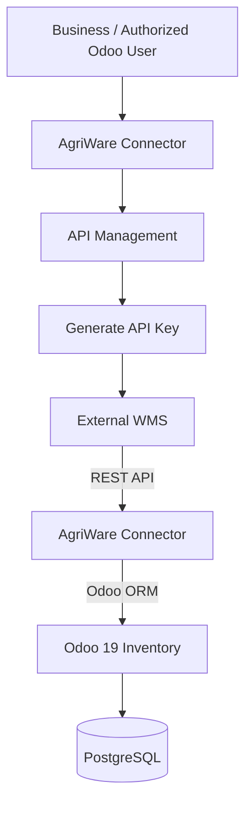

# AgriWare Connector

AgriWare Connector is a free, open-source Odoo 19 application that enables businesses to connect
a compatible external Warehouse Management System (WMS) to Odoo Inventory. It exposes a
standardized REST API that an external WMS can use to exchange product, warehouse, and inventory
information, and to create and validate stock receipts and dispatches.

**AgriWare Connector is not itself a warehouse management system.** It does not manage racking,
picking routes, barcode scanning hardware, or any other WMS-side operation — it is the integration
layer between an existing WMS and Odoo's Inventory app.

See the [connector navigation guide](docs/CONNECTOR_NAVIGATION.md) for the current
menu layout, dashboard, synchronization history, and role permissions. API Management
is now under **AgriWare Connector → Integrations & Configuration → Configuration**.

## Table of contents

1. [Documentation](#documentation)
2. [Project overview](#project-overview)
3. [Who it is for](#who-it-is-for)
4. [Key features](#key-features)
5. [How AgriWare Connector works](#how-agriware-connector-works)
6. [System architecture](#system-architecture)
7. [Installation](#installation)
8. [API key management](#api-key-management)
9. [Connecting an existing WMS](#connecting-an-existing-wms)
10. [Supported API operations](#supported-api-operations)
11. [Security](#security)
12. [Free software and paid services](#free-software-and-paid-services)
13. [Known limitations](#known-limitations)
14. [Development and testing](#development-and-testing)
15. [Contributing](#contributing)
16. [License](#license)
17. [Professional services](#professional-services)

## Documentation

| Guide | For | Covers |
|---|---|---|
| [Quick Start Guide](docs/QUICK_START.md) | Everyone | The shortest path through the whole workflow, with a minimal working example. |
| [Installation Guide](docs/INSTALLATION.md) | Business users, no Odoo dev experience required | Downloading the marketplace package (which bundles its own OCA dependencies), assigning permissions, generating a key, and testing the connection. |
| [WMS Integration Guide](docs/WMS_INTEGRATION.md) | Developers configuring the WMS side | Architecture, authentication, every endpoint with request/response examples, idempotency, and error handling. |
| [API Reference](docs/API.md) | Developers | The complete, field-by-field technical specification of every endpoint. |
| [Customer Onboarding](docs/CUSTOMER_ONBOARDING.md) | New customers | A 9-step checklist from download to operational use, linking into the guides above. |
| [Customer Support](docs/SUPPORT.md) | Anyone with a problem or request | How to report installation/API issues, bugs, and feature requests via GitHub Issues. |
| [Professional Services](docs/PROFESSIONAL_SERVICES.md) | Businesses wanting paid help | What's free vs. optional paid services — installation help, custom integration, support. |
| [Integration Services](docs/INTEGRATION_SERVICES.md) | Businesses needing a custom WMS integration | The paid integration process and a requirements questionnaire. |
| [Guide de démarrage rapide (FR)](docs/QUICK_START_FR.md) | French-speaking users | French translation of the Quick Start Guide. |
| [Présentation commerciale (FR)](docs/PRESENTATION_COMMERCIALE_FR.md) | French-speaking agribusinesses and Odoo partners | What the module does, who it's for, and how to request integration support, in French. |

## Project overview

AgriWare Connector integrates an existing, compatible WMS with Odoo 19's Inventory app through a
REST API. The external WMS calls this API to read Odoo's product, warehouse, and stock data, and
to push incoming receipts and outgoing dispatches into Odoo's standard stock workflow
(`stock.picking` / `stock.move`). Odoo itself never calls out to the WMS — every request in this
integration is initiated by the external system.

## Who it is for

- Agricultural cooperatives
- Agribusinesses
- Agricultural processors
- Agricultural input distributors
- Warehouse operators
- Businesses already using Odoo 19
- Businesses with existing external WMS software

The project originated for agribusinesses operating in Côte d'Ivoire and other African markets,
but nothing in the module restricts it to any particular country or region.

## Key features

All of the following are implemented and covered by the automated test suite:

- REST API integration with Odoo 19
- Product information retrieval
- Warehouse information retrieval
- Inventory information retrieval
- Stock receipt creation
- Stock receipt validation
- Stock dispatch creation
- Stock dispatch validation
- Bearer-token authentication (Odoo API keys)
- Self-service API key management, directly inside Odoo:
  - API key generation
  - API key expiration (a chosen date, or none)
  - Never-expiring API keys
  - API key revocation
  - API key replacement
  - Multiple API keys per company, for different WMS integrations
- Role-based access control (`AgriWare API User`, `AgriWare Administrator` groups)
- Multi-company security controls (record rules scope API keys to their own company)
- Duplicate transaction protection (advisory-locked, concurrency-safe)

## How AgriWare Connector works

**Step 1.** The business installs AgriWare Connector inside its Odoo 19 environment.

**Step 2.** An authorized business user (a member of the **AgriWare Administrator** group — see
[API key management](#api-key-management)) opens **AgriWare Connector → API Management**.

**Step 3.** The user generates an API key, giving it an integration name (e.g. "Main Warehouse
Integration"). Multiple keys can be generated, one per WMS integration if needed.

**Step 4.** The user chooses an expiration date for the key, or selects **Never Expires**.

**Step 5.** The generated key is displayed exactly once, in a dialog; the business copies it
immediately — it cannot be retrieved again afterward, since only a salted hash is stored.

**Step 6.** The business configures its existing WMS with two values: the Odoo instance's API base
URL, and the generated API key.

**Step 7.** The external WMS calls the AgriWare Connector REST API, authenticating every request
with that key.

**Step 8.** AgriWare Connector processes each request using Odoo's ORM and Odoo's own security
permissions (the group and company checks described in [Security](#security)) — every read or
write goes through the same access control any other Odoo client would be subject to.

**Step 9.** The business can revoke a key immediately, or generate a replacement, at any time —
without contacting AgriWare's developers.

The external WMS must implement the AgriWare REST API specification documented in
[docs/API.md](docs/API.md), or use a custom adapter (see
[Free software and paid services](#free-software-and-paid-services)).

## System architecture



The external WMS initiates every REST API request shown above; AgriWare Connector never calls out
to the WMS. All data ultimately lives in Odoo's own PostgreSQL database — AgriWare Connector adds
no separate datastore.

## Installation

This section covers building AgriWare Connector **from source** for development, where the OCA
dependencies are not part of this Git repository (see [`.gitignore`](.gitignore)) and must be
fetched separately, as shown below. If you're a business installing the module from the Odoo Apps
Marketplace rather than building from source, see the [Installation Guide](docs/INSTALLATION.md)
instead — the marketplace package bundles its own copies of the OCA dependencies, so no separate
cloning step is needed there.

### Requirements

- Odoo 19
- PostgreSQL 16
- Docker and Docker Compose (for the development environment described below)
- Python packages: `openupgradelib`, `cachetools` (installed automatically by the provided
  `Dockerfile`)

### OCA dependencies

AgriWare Connector depends on the following Odoo Community Association modules:

| Module | Version | Repository | Pinned commit |
|---|---|---|---|
| component | 19.0.1.0.1 | https://github.com/OCA/connector | `cce76545ea56b85864fde9a1afb69748bc766e99` |
| component_event | 19.0.1.0.0 | https://github.com/OCA/connector | `cce76545ea56b85864fde9a1afb69748bc766e99` |
| connector | 19.0.1.0.0 | https://github.com/OCA/connector | `cce76545ea56b85864fde9a1afb69748bc766e99` |
| queue_job | 19.0.2.1.6 | https://github.com/OCA/queue | `da2664795eb525698f93dfdd63f6ba5c4c9fccba` |

These are declared as dependencies of the `connector` module chain. AgriWare Connector's own code
does not currently use their job-queue or synchronization features (see
[Known limitations](#known-limitations)). Use the pinned commits above rather than tracking the
`19.0` branch directly, since upstream can advance independently of this project.

### Installing from source

**1. Clone the repository**

```bash
git clone git@github.com:DOINGGOODPROJECTS/agriwareodoo.git
cd agriwareodoo
```

**2. Configure environment variables**

```bash
cp .env.example .env
nano .env
```

Replace the placeholder password with your own PostgreSQL password.

**3. Install the OCA dependencies**

```bash
git clone https://github.com/OCA/connector.git /tmp/oca-connector
git -C /tmp/oca-connector checkout cce76545ea56b85864fde9a1afb69748bc766e99
cp -r /tmp/oca-connector/component ./component
cp -r /tmp/oca-connector/component_event ./component_event
cp -r /tmp/oca-connector/connector ./connector

git clone https://github.com/OCA/queue.git /tmp/oca-queue
git -C /tmp/oca-queue checkout da2664795eb525698f93dfdd63f6ba5c4c9fccba
cp -r /tmp/oca-queue/queue_job ./queue_job

rm -rf /tmp/oca-connector /tmp/oca-queue
```

This results in the following directories at the project root (all excluded from version control
by `.gitignore`, since they are third-party dependencies, not part of this project):

```text
component/
component_event/
connector/
queue_job/
```

**4. Start Odoo**

```bash
docker compose up -d --build
```

Open Odoo at `http://localhost:8069`.

### Module activation

1. Log in to Odoo.
2. Activate developer mode.
3. Navigate to **Apps**.
4. Update the Apps List.
5. Search for **AgriWare Connector**.
6. Install the module.

### Required user permissions

Installing the module does not, by itself, grant anyone access to the API. An administrator with
Odoo's own **Settings** access must assign the **AgriWare Administrator** group (Settings → Users
& Companies → Users → Access Rights) to whichever business user(s) should manage API keys. See
[API key management](#api-key-management) for what that group can do.

## API key management

### Who can generate keys

Only users in the **AgriWare Administrator** group. This is distinct from the **AgriWare API
User** group, which is the group the API key's underlying identity needs in order to call the
REST endpoints — a human never needs to be in that group themselves.

### How keys are generated

**AgriWare Connector → API Management → Generate API Key**, then:
1. Enter an integration name.
2. Choose an expiration date, or check **Never Expires**.
3. Click **Generate**.

The key is shown exactly once, immediately after generation, in a dialog box. Copy it right away —
Odoo cannot show it to you again.

### How expiration works

If an expiration date is set, the key stops authenticating automatically once that date passes —
enforced by Odoo's own API key infrastructure at the database layer, not by application code that
could be bypassed.

### Never Expires

A key can instead be created with no expiration date, remaining valid until someone explicitly
revokes it.

### How to revoke keys

From **AgriWare Connector → API Management → API Keys**, click **Revoke** on any key. This takes
effect immediately: the underlying credential is deleted, and the very next request using that key
is rejected.

### How to replace expired or revoked keys

Click **Create New** on an expired or revoked key's row. This opens the generate wizard pre-filled
with that key's integration name and expiration policy, so replacing a key doesn't mean re-typing
everything from scratch.

### Multiple keys for different WMS applications

Each company can hold any number of API keys — for example, one per warehouse or per WMS
integration. They share one underlying integration identity per company but are independently
named, timed, and revocable.

### Security recommendations

- Treat every generated key as a secret: store it in the external system's secret manager, never
  in source control or plaintext configuration files.
- Prefer an expiration date over Never Expires unless the integration genuinely needs a
  long-lived credential.
- Revoke a key immediately if you suspect it has leaked.
- Only grant the **AgriWare Administrator** group to business users who should be trusted to
  manage API credentials — see [Security](#security).

Full technical and security details are in [docs/API.md](docs/API.md).

## Connecting an existing WMS

Once you have a generated key (see [API key management](#api-key-management)):

```bash
curl -s YOUR_ODOO_URL/agriware/api/v1/products \
  -H "Authorization: Bearer YOUR_API_KEY"
```

```json
{
  "status": "success",
  "count": 2,
  "products": [
    {"id": 14, "name": "Urea 50kg Bag", "default_code": "FERT-UREA-50", "barcode": "6161100000012", "active": true},
    {"id": 15, "name": "Maize Seed 25kg Bag", "default_code": "SEED-MAIZE-25", "barcode": "", "active": true}
  ]
}
```

The WMS should expect this response pattern — `{"status": "success", ...}` or
`{"status": "error", "message": "..."}` — on every endpoint, and must be able to issue an
`Authorization: Bearer <key>` header on each request. See [docs/API.md](docs/API.md) for the
complete request/response contract of every endpoint, including receipt and dispatch creation.

Some WMS platforms will need custom integration development to speak this API — see
[Free software and paid services](#free-software-and-paid-services).

## Supported API operations

| Method | Endpoint | Description |
|---|---|---|
| GET | `/agriware/api/v1/health` | API health check |
| GET | `/agriware/api/v1/products` | Retrieve products |
| GET | `/agriware/api/v1/warehouses` | Retrieve warehouses |
| GET | `/agriware/api/v1/inventory` | Retrieve inventory |
| POST | `/agriware/api/v1/receipts` | Create stock receipt |
| POST | `/agriware/api/v1/receipts/{id}/validate` | Validate receipt |
| POST | `/agriware/api/v1/dispatches` | Create stock dispatch |
| POST | `/agriware/api/v1/dispatches/{id}/validate` | Validate dispatch |

Full request/response schemas, authentication details, and error responses for every endpoint are
documented in [docs/API.md](docs/API.md).

## Security

- **API key authentication**: every protected endpoint requires a Bearer token that is a real
  Odoo API key.
- **Access control**: the authenticated user must additionally belong to the **AgriWare API User**
  group (or a group that implies it) — a valid key alone is not sufficient.
- **Company restrictions**: warehouses, partners, and products are looked up scoped to the caller's
  companies; API key records are further isolated per-company by record rules, so one company's
  administrators can never see or revoke another company's keys.
- **API key expiration and revocation**: enforced by Odoo's own API key infrastructure at
  authentication time, independent of this module's own code.
- **Secure credential storage**: API keys are stored as a salted hash only, never in plaintext,
  matching Odoo's own design; the `agriware.connection` model's manually-entered API key field is
  similarly restricted to Odoo System Administrators.
- **HTTPS recommended**: deploy behind TLS in any environment that isn't purely local development —
  Bearer tokens sent over plain HTTP are visible to anyone on the network path.
- **Duplicate transaction protection**: a PostgreSQL transaction-scoped advisory lock serializes
  concurrent receipt/dispatch creation requests sharing the same external reference.

See [Known limitations](#known-limitations) for gaps not yet addressed. Additional security
hardening is recommended before production deployment.

## Free software and paid services

AgriWare Connector is free and open-source (LGPL-3.0) — no mandatory licensing or subscription
fee, ever.

**Free, included with the software:**

- Download and installation of the open-source module
- API key generation and management
- Access to all supported REST API functionality
- Self-service integration with compatible WMS software

**Optional, paid professional services** (separate from the software itself):

- Custom WMS integration for systems not natively compatible with this API
- Development of WMS adapters
- Installation and configuration
- Technical support and maintenance
- Custom feature development

These services are entirely optional. Businesses only pay AgriWare if they choose to use one of
them; the software itself remains free either way. Full details, and how to request a service:
[docs/PROFESSIONAL_SERVICES.md](docs/PROFESSIONAL_SERVICES.md).

## Known limitations

Verified against the current implementation:

- No pagination: the `products`, `warehouses`, and `inventory` list endpoints hard-cap at 100
  records, with no offset/cursor parameter.
- No per-warehouse access control: any user in the AgriWare API User group can act on any
  warehouse within their allowed companies.
- Partial receipts and partial dispatches are not supported; quantities must match exactly.
- Lot/serial-tracked products are explicitly rejected by dispatch validation. Receipt validation
  has no equivalent explicit check — this is a known inconsistency, not a verified-safe code path.
- Multiple move lines for the same product on one receipt are not supported.
- No automatic or scheduled synchronization: every request is initiated by the external WMS: there
  is no polling, cron job, or scheduled task inside this module.
- No bidirectional synchronization: AgriWare Connector never calls out to the WMS. All
  communication is WMS-initiated.
- No built-in WMS-specific adapters: the module exposes one generic REST API; translating that to
  a WMS's own native protocol, where needed, is custom integration work (see
  [Free software and paid services](#free-software-and-paid-services)).
- Lot/serial-tracked products are rejected consistently on **both** receipt and dispatch
  validation, with the same `409` error (`"Lot or serial tracking is not supported yet"`),
  verified by automated tests covering lot-tracked and serial-tracked products on each endpoint.
- The `agriware.connection` model ("WMS Connections") exists in the codebase but is unused by the
  current, inbound-only API architecture — the REST API never reads this model. It appears to have
  been built for a different, outbound direction (Odoo calling out to a WMS) that was never
  implemented. Its menu and "Test Connection" action are hidden from normal users (reachable only
  with "Technical Features" enabled in Settings → Users) to avoid advertising functionality that
  doesn't work; the model, its views, and any existing records are preserved, not deleted.

## Development and testing

The development environment is Docker Compose-based (Odoo 19 + PostgreSQL 16; see
[Installation](#installation)).

**Running tests safely.** Automated tests must never run against your real data. Create a
throwaway database, run the test suite against it, then drop it:

```bash
docker compose exec odoo bash -c \
  'odoo -d throwaway_test_db --db_host=db --db_user=odoo --db_password="$PASSWORD" \
   --http-port=8070 -i agriware_connector --test-enable --test-tags /agriware_connector \
   --stop-after-init --log-level=test'
```

Then drop the database when done:

```bash
docker compose exec db psql -U odoo -d postgres -c "DROP DATABASE throwaway_test_db;"
```

The test suite uses Odoo's `HttpCase` to make real HTTP requests against the running test server,
covering authentication, authorization, catalog endpoints, receipt/dispatch create and validate
flows, and the full self-service API key lifecycle (generation, expiration, revocation,
replacement, and company-level isolation).

## Contributing

This project is developed in the open on GitHub:
https://github.com/DOINGGOODPROJECTS/agriwareodoo

To contribute: open an issue describing the change you'd like to make or the bug you've found,
fork the repository, and open a pull request against `main`. Please run the automated test suite
against a throwaway database (see above) before submitting.

## License

LGPL-3.0. See [LICENSE](LICENSE).

## Professional services

AgriWare Connector itself is always free — optional paid services (installation help, custom WMS
integration, adapter development, technical support) are available separately. See
[docs/PROFESSIONAL_SERVICES.md](docs/PROFESSIONAL_SERVICES.md) for what's included, and
[docs/INTEGRATION_SERVICES.md](docs/INTEGRATION_SERVICES.md) for how to request a custom WMS
integration specifically. For bug reports, questions, or feature requests, see
[docs/SUPPORT.md](docs/SUPPORT.md).
